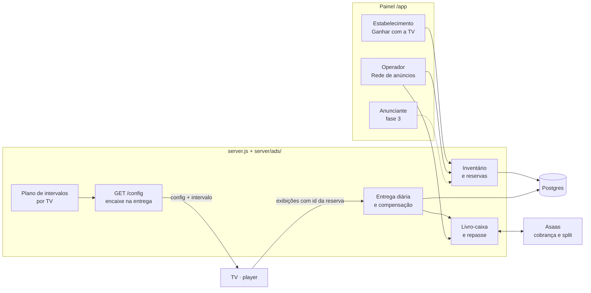
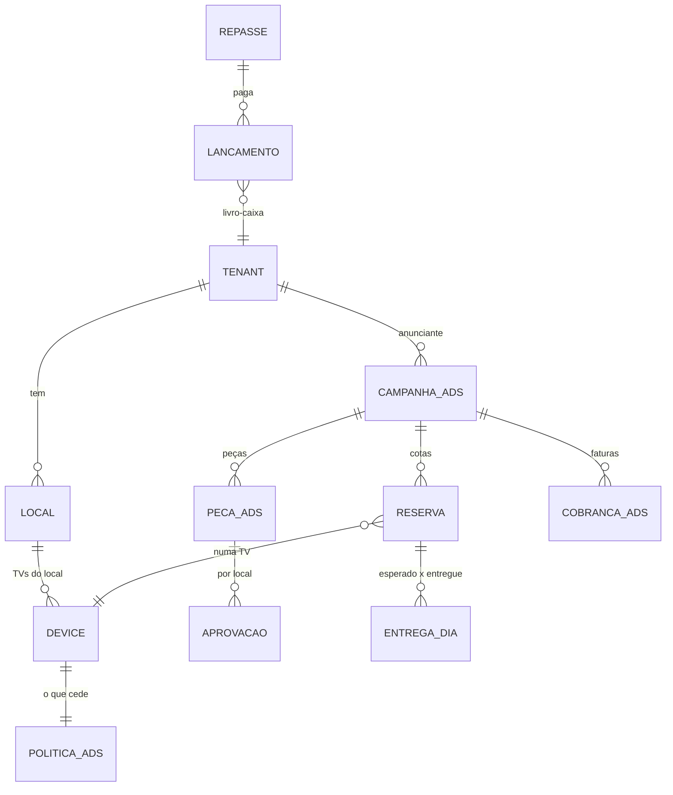

# 5. Arquitetura técnica

Princípio: **um módulo dentro do produto**, não outro sistema. Reaproveita
pareamento, player, proof-of-play, cobrança, painel de operador e o canal ao
vivo.

## Visão geral



## Separação entre conteúdo próprio e publicidade

- A programação do dono continua em `devices.config`, **intocada**.
- Os anúncios **não são gravados** na config: o servidor monta, na hora de
  entregar `GET /api/devices/:id/config`, um bloco `intervalo` a partir das
  reservas ativas daquela TV — o mesmo lugar onde hoje entram logo,
  aniversários e QR de foto.
- Consequência boa: o dono não consegue apagar um anúncio editando a
  programação, e o anúncio sai sozinho quando a reserva termina.

```json
"intervalo": {
  "a_cada_s": 300,
  "vagas": [
    { "reserva": "rsv_8f2…", "peca": { "type": "image", "src": "/media/…", "duracao": 10 } },
    { "reserva": "rsv_91a…", "peca": { "type": "video", "src": "/media/…", "duracao": 10 } }
  ],
  "horario": { "dias": [1,2,3,4,5,6], "inicio": "06:00", "fim": "22:00" },
  "versao": "2026-11-01T10:00Z"
}
```

## Integração com o player

- Uma camada nova, **intervalo comercial**, irmã do "aviso urgente" que já
  existe (`takeover` em `js/player.js`): a cada `a_cada_s`, dentro do
  horário, cobre a zona principal, roda as vagas em sequência e devolve a
  tela. Vídeos e lives de baixo seguem como no takeover de hoje.
- As peças entram no pré-cache de mídia que já existe (tocam sem internet).
- O relógio do intervalo é o do player, mas o **horário** passa a ser
  conferido também pelo servidor (a config já leva o fuso); TV com relógio
  errado não ganha horário nobre.

## Logs de reprodução

- `js/exibicoes.js` já agrega por hora × zona × chave. O anúncio entra com
  `chave = "ads:" + reserva + ":" + peca` e zona `intervalo`.
- Tabela nova `exibicoes_ads` (ou coluna `reserva_id` em `exibicoes`), com o
  mesmo envio em lotes e a mesma deduplicação.
- **Anti-fraude** (fase 2): o lote leva uma assinatura HMAC com uma chave
  por TV entregue na config (não o token da TV); o servidor recusa
  exibições em horas em que a TV não deu sinal de vida (`last_seen` por
  hora), acima do máximo possível de intervalos por hora, ou de uma reserva
  que não estava ativa. Amostra: o "ver a tela agora" é pedido em horários
  aleatórios e confere se o intervalo aparece.

## Entidades (modelo conceitual)



| Entidade (nome sugerido) | Precisa? | Por quê |
|---|---|---|
| **local** (venue) | Sim | Endereço, tipo de local, faixa de movimento, fuso; uma empresa pode ter vários locais e um local várias TVs. Hoje "grupo" é texto livre e não serve |
| **politica_ads** (ad inventory) | Sim | Por TV: participa?, intervalo, vagas, horário cedido, categorias vetadas. Pode ser coluna JSON em `devices` no começo |
| pacote (ad package) | Depois | Começa como filtro salvo (região + tipo) sobre locais; vira tabela quando houver preço por pacote |
| **campanha_ads** | Sim | Do anunciante; período, segmento, estado. Separada de `campanhas` (que são as peças da IA) para não misturar |
| **peca_ads** (creative) | Sim | Mídia + duração + estado de revisão |
| **aprovacao** | Sim | Peça × local: pendente/aprovada/vetada, quem e quando |
| **reserva** (booking) | Sim | Campanha × TV × período × vagas; estado (proposta, confirmada, no ar, encerrada, cancelada) |
| agenda de intervalos (ad schedule) | Não como tabela | É derivada das reservas na hora de entregar a config |
| **exibicoes_ads** (playback log) | Sim | Exibições com o id da reserva |
| **entrega_dia** | Sim | Esperado × entregue por reserva por dia; base da compensação e do repasse |
| **lancamento** (revenue share) | Sim | Livro-caixa de partidas dobradas: recebido, comissão, a repassar, repassado, ajuste |
| **repasse** (payout) | Sim | Por estabelecimento por mês, com comprovante |

## Contas, isolamento e permissões

- `tenants.tipo`: `empresa` (hoje), `anunciante`. Um estabelecimento é uma
  empresa com locais na rede.
- **1 usuário = 1 empresa** é um limite real: a agência que atende 5
  anunciantes, ou o dono de academia que também anuncia, precisaria de
  contas separadas. Começar assim (operador cria os anunciantes); trocar por
  `membros (user_id, tenant_id, papel)` antes do portal do anunciante.
- Visibilidade cruzada **só pela reserva**: o estabelecimento vê a peça e o
  nome do anunciante das reservas nas TVs dele; o anunciante vê as TVs das
  reservas dele (nome do local e bairro, nunca dados da conta). Toda consulta
  filtra por `tenant_id` + junção pela reserva — com teste de rota como os de
  `test/seguranca-rotas.test.js`.
- Considerar Row Level Security no Postgres para as tabelas novas (o
  isolamento hoje é só na aplicação).

## Integridade transacional

- Reserva: transação com `SELECT … FROM devices WHERE id = $1 FOR UPDATE`,
  soma das vagas no período, insere ou recusa. Índice em
  `reserva (device_id, inicio, fim)`.
- Dinheiro: só `lancamento` (imutável, partidas dobradas); saldo é soma.
  Webhook do Asaas idempotente pelo id do pagamento (já é assim hoje com
  `pacotes_pagos`).
- **Migrations de verdade** antes da primeira tabela de dinheiro: o
  `CREATE/ALTER IF NOT EXISTS` duplicado em SQLite e Postgres não aguenta
  restrições, chaves estrangeiras e mudanças de tipo com segurança. (O QA já
  recomenda Postgres em todo lugar.)

## Pagamentos

- Cobrança do anunciante: cobrança avulsa ou assinatura do Asaas (o código
  já sabe fazer as duas), `externalReference` com o id da campanha.
- Repasse: fase 1 Pix manual a partir do extrato; fase 2 split do Asaas para
  a carteira do estabelecimento (exige subconta com KYC dele) com ajuste da
  entrega no mês seguinte.

## Comunicação em tempo real e escala

- O intervalo vai na config, que já chega pelo SSE: reserva nova → `broadcast`
  para as TVs afetadas.
- Para a rede passar de algumas centenas de TVs, tirar da memória o canal ao
  vivo, os comandos e os passes (Redis ou `LISTEN/NOTIFY` do Postgres) e
  rodar duas réplicas — também resolve "cada deploy derruba todas as
  conexões".

## Notificações

E-mail (já existe) e, quando houver integração, WhatsApp:
- estabelecimento: peça para aprovar, repasse feito, TV com campanha fora do ar;
- anunciante: campanha no ar, relatório semanal, renovação;
- operador: entrega abaixo de 90%, pagamento recebido/atrasado.

## Riscos técnicos

| Risco | Impacto | Mitigação |
|---|---|---|
| Fraude na contagem pela TV do estabelecimento | Paga por exibição que não houve | Assinatura do lote, cruzamento com sinal de vida, amostragem por "ver a tela" |
| Relógio da TV decide o horário | Anúncio fora da faixa vendida | Horário conferido pelo servidor; TV com relógio errado não entra na faixa |
| Uma instância só | Rede inteira cai junto num deploy | Healthcheck (feito), estado fora da memória antes de escalar |
| Schema sem migrations, em dois bancos | Erro em tabela de dinheiro | Migrations + Postgres em todo lugar antes das tabelas de dinheiro |
| 1 usuário = 1 empresa | Agência/anunciante-estabelecimento | Tabela de membros antes do portal do anunciante |
